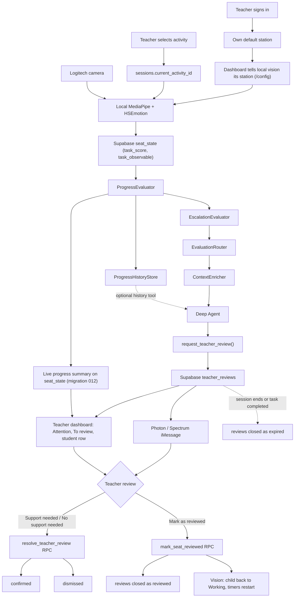

# Cues

Cues uses local vision and structured task progress to help teachers notice when
a student may need attention. Built by Keith, Michelle, and Evan for HackPrinceton 2026.

The continuous agent worker polls structured state and selects information/action
tools adaptively. Groq `openai/gpt-oss-20b` is the current demo model; the core
agent remains provider-independent through model injection. FastAPI serves local
vision/video. Pending reviews persist in Supabase; teacher resolution records a
human decision without automatically changing instruction.

## How it decides

**Scoring.** Each person is scored on the task the teacher started. A score is a number
only when Cues has evidence for that task: a wrist or hand it can see and judge. When it
does not (shoulders or wrists too faint, no hand found, no recogniser result), the score
is empty and `task_observable` is false. That is missing evidence, never a failure, and
it is kept apart from `tracking_valid`, which only says the person is tracked. A judged
wrong attempt is a low number (0.0 included) and can count toward a stall.

**Progress.** `ProgressEvaluator` reads each snapshot for the active session, activity
and revision. Tracking invalid or task not observable is `unknown` and clears the window.
Observable and not improving becomes `stalled`; reaching the success threshold is
`completed`. Success is 0.7 for raise-hand and 0.6 for open palm, which the recogniser
rarely scores above 0.7 on a laptop camera (`vision/activities.json`).

**When the teacher is asked.** Only when progress has stalled for long enough (10 seconds,
or 15 for an urgent request; the demo profile uses shorter times) and the Deep Agent then
writes a pending `teacher_review`. Expression context can only raise an existing stall.
No review is written when the agent call fails.

**What the dashboard shows.** Attention, To review and the pending count come from pending
`teacher_reviews` only. A student card shows "Check in" only when a review is pending,
and only a review has Support needed / No support needed. A raw vision status reads as a
neutral observation (for example "Low task match"). Rows count as current only when they
match the active session, activity and revision. Camera wording comes from the local
vision `/health`; the feed's connection is reported separately.

Video stays local. Raw frames/images never go to the LLM. Expression context is
supporting-only, never a diagnosis or a claim about internal emotional state.
Tracking loss is not student failure. The teacher remains the final decision-maker.
Use simulated data during the hackathon.

| Component | Stack |
|---|---|
| Dashboard | Next.js / Tailwind |
| Perception | MediaPipe / HSEmotion ONNX / Logitech camera |
| Local video service | FastAPI |
| State and reviews | Supabase Postgres + Realtime |
| Agent | LangChain Deep Agents; Groq demo model |
| Notifications | Photon 2.0 through Spectrum iMessage |

| Path | Ownership / contents |
|---|---|
| `vision/` | Keith: local perception, camera, structured publication |
| `agent/` | Michelle: progress/routing, agent, reviews, notifications |
| `web/` | Evan: dashboard/app integration |
| `shared/` | Authoritative Pydantic contracts and fixtures |
| `supabase/` | Ordered migrations and SQL checks |
| `cues/` | Nested Spectrum SDK project, on-demand notification sender |
| `notes/` | All documentation: product spec, database, web, vision and agent notes (index: [notes/README.md](notes/README.md)) |
| `.github/` | CI workflows (`vision`, `web`, `supabase`) and the PR template |
| `STARTUP.md` | Setup, env requirements, operational troubleshooting |

See [STARTUP.md](STARTUP.md), then run `./scripts/dev.sh` to start vision, the
agent worker, and dashboard together (`./scripts/demo.sh` is the same stack with shorter
progress and escalation times). Leave `CUES_STATION_ID`, `CUES_SESSION_ID` and
`CUES_STATION_OVERRIDE` unset: the signed-in teacher's station and the active session
are resolved at run time. Text alerts need `SPECTRUM_PROJECT_ID` and
`SPECTRUM_PROJECT_SECRET` in `cues/.env`. Photon runs on demand. Voice is not required
by this startup flow. What vision writes, and how the other two areas use it, is in the
[vision handoff](notes/vision-data.md); what is still open is ranked in
[outstanding work](notes/outstanding-work.md).

Dashboard activity writes and persistent teacher review controls are connected.
Live progress requires migration 012 and both `agent.live_progress` and
`web.live_progress` turned on. `seat_state.task_observable` comes from migration
`20261115000100_task_observable.sql`; until it is applied, vision and the agent use the
score alone (empty means not observable).
See [pipeline audit](notes/pipeline-audit.md) for every connection and remaining limits.
MJPEG `/stream` is the intentional local demo transport; WebRTC is not required.

Python dependencies use root uv; Node packages use their npm lockfiles. Follow
[notes/archive/TEAM_WORKFLOW.md](notes/archive/TEAM_WORKFLOW.md) for branches and ownership, and
[notes/PRD-cues.md](notes/PRD-cues.md) for product requirements. Shared Python contracts in
`shared/contracts.py` are authoritative.
