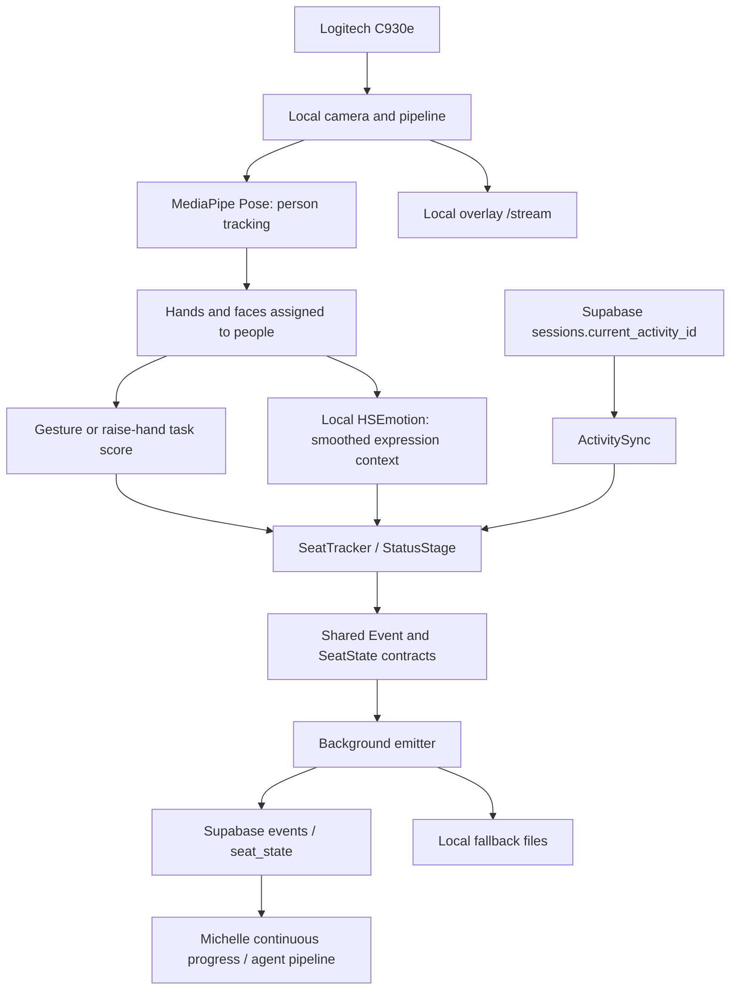

# Keith — vision / local perception

Consolidated implementation status: November 14, 2026. Keith owns `vision/`;
Michelle owns downstream progress/routing and Evan owns dashboard/app integration.
This summary replaces superseded fixed-seat and milestone plans.

## Implemented architecture



Vision publishes observations and low-level status. Teacher-review decisions
belong to Michelle's pipeline. Camera frames, face crops and landmarks stay local;
cloud publication contains structured state only. No face recognition is used.

## Camera, people and overlay

The station uses a Logitech C930e. Capture requests 1280×720; processing uses
960×540, preserving the wide 16:9 view. Set CUES_CAMERA_INDEX to select the camera
(default 0; USB is often 1). CUES_CAMERA=fake supports camera-free service checks.

MediaPipe Pose tracks up to four people as station-prefixed IDs such as S1-P1.
Fixed left/right seats and their divider/swap routes are removed; CUES_GROUPING
does not select a fixed-seat fallback. Tracks are released after ten seconds
unseen, and the lowest available number can be reused. IDs describe temporary
tracks, not persistent student identity. Consumers must not assume that a reused
ID identifies the same child.

Hands/faces are associated with tracked people. The overlay shows person/face
labels, a selected hand skeleton and task score, threshold colors, and connecting
lines. Gestures select the best-matching hand; raise-hand selects the highest hand.
Debug overlay exposes additional local detail. Gesture detection always runs: every
known gesture is checked and a completed one is shown green on the video. It is
display-only, not a replacement for the assigned-task state feed. Raise-hand
(task score and detection) requires an open palm facing the camera.
Built-in gestures (MediaPipe Gesture Recognizer, no recording): `thumbs_up`
(Thumb_Up) and `open_palm` (Open_Palm, success 0.6 / review 0.5). When a raised
open palm completes both, `raise_hand` wins over `open_palm`.

`open_palm` succeeds at 0.6, not 0.7, because the recogniser's Open_Palm score is a class
probability that rarely reaches 0.7 for a real palm on a laptop webcam. Measured locally:
22 correct palms scored min 0.589, median 0.636, mean 0.634, max 0.698; 24 closed fists all
scored 0.000. Passing at each threshold: 0.70 none of 22, 0.65 five of 22, 0.60 twenty of 22;
no fist passed at any of them. Raise-hand (0.7 / 0.4) and the other gestures are unchanged.
The same value is in `vision/activities.json` (which the agent also reads) and `supabase/seed.sql`
(migration 014 still creates the row at 0.7; the seed, which runs after migrations, updates it).

## Tasks and perception

| Task | Implementation | Success / review |
|---|---|---|
| thumbs_up | MediaPipe Gesture Recognizer Thumb_Up; no recordings required | 0.70 / 0.50 |
| raise_hand | Pose wrist height above shoulders, scaled by shoulder width and landmark visibility | 0.70 / 0.40 |
| custom_gesture_01 | Normalized landmark template matching | 0.78 / 0.58 |

Configuration lives in vision/activities.json. Custom gesture scores are match
scores, not calibrated probabilities. Templates remain local; current geometry
uses aspect correction and template format 4, so incompatible old custom recordings
must be replaced. Do not record thumbs_up merely to enable the built-in recognizer.

HSEmotion runs locally with its eight native classes, smoothing over two seconds.
Published expression_context is null unless anger/fear/sadness qualifies at
probability ≥0.5 for at least five seconds. Qualifying context includes label,
probability, duration_seconds and supporting_only=true. It never changes task
status or independently triggers review; it is not a diagnosis or internal-state claim.

## State, events and current activity

StatusStage and SeatTracker implement idle, in_progress, review, done, needs_help
and tracking_lost. Vision emits attempt_success, attempt_miss, review_needed,
no_progress, tracking_lost and expression_context events through the canonical
shared models. These low-level events do not directly request teacher review.
Vision's activity timeout is separate from Michelle's rolling-progress policy.

SeatState is the primary integration feed. It is upserted on seat_id when status
or tracking validity changes and otherwise about once per second. updated_at is
the frame observation time converted to UTC, rather than the network send time.
Rows include session/activity identity, status, tracking_valid, task_score and
optional qualifying expression context.

tracking_valid=true means the current person/face/hand observation is usable;
false clears task_score to null, including initial missed frames before the
tracking_lost status delay. Missing tracking must never become a low score or
student failure. Local vision timers pause during tracking loss.

With vision.activity_sync enabled, ActivitySync reads the configured session's
current_activity_id once per second and updates the class task. Unknown local
activity IDs are ignored with a warning. CUES_TASK supplies the local initial
task (default thumbs_up); programmatic per-person overrides also exist.

The emitter queues writes on a background thread. With vision.supabase_events
and backend credentials, it sends events and complete SeatState upserts to
Supabase. Otherwise, or after failed cloud writes, events append to
vision/logs/events.jsonl and state replaces the latest per-person snapshot in
vision/logs/seat_state.json. Live expression snapshots are not accumulated there
as a per-frame history.

## Service and recording API

FastAPI entrypoint: vision.app:app. Implemented local endpoints include /health
and /stream, plus gesture-flag-gated template endpoints:
- POST /templates/record with activity_id, label target/rest, seconds and optional seat_id.
- GET /templates/{activity_id}.
- DELETE /templates/{activity_id}.

Recording uses the running pipeline's observations. No detected hand yields a
clean recording error. Built-in gestures do not require custom templates.

## Running and flags

Use the shared Python 3.11 uv environment. Complete stack setup is in STARTUP.md.

```bash
./scripts/dev.sh
uv run uvicorn vision.app:app --host 127.0.0.1 --port 8000
uv run python -m vision.watch --all-on --debug
uv run python -m vision.watch --all-on --task custom_gesture_01
CUES_CAMERA=fake uv run python -m vision.watch --all-on --seconds 5
uv run python -m vision.record custom_gesture_01 target --takes 3
uv run python -m vision.record custom_gesture_01 rest --takes 2
uv run pytest vision
```

Registry flags default off: vision.hands, faces, gestures, expression, raise_hand,
task_status, activity_sync, supabase_events and all_scores. Set the corresponding
CUES_FLAG_VISION_* environment variable to 1. watch --all-on enables its perception,
status and display flags; it does not automatically enable cloud publication or
activity sync. Cloud publishing requires SUPABASE_URL,
SUPABASE_SERVICE_ROLE_KEY and a station: the signed-in teacher's dashboard sends it to `POST /config`, or `CUES_STATION_ID` pins it for dev/test. `CUES_SESSION_ID` is for legacy/smoke commands only. The launcher turns the needed flags on.
Keep credentials backend-only and the video stream local.

## Verified integration and remaining work

Migration 005 added nullable seat_state.tracking_valid with no default to hosted
Supabase. The real SupabaseSink upsert/read check persisted true with a score and
false with null score, with updated_at advancing. The synthetic probe was removed.
Unknown historical tracking remains null.

Michelle's continuous SeatState consumer is implemented. A hosted scripted smoke
consumed synthetic observations, detected a stall, persisted a pending teacher
review and received one Spectrum acknowledgement; probe rows were cleaned up.
That validates integration mechanics, not camera accuracy or live-model judgment.
Full offline suite (2026-11-14): about 619 passed, 4 skipped (hardware/credential gated), plus 60 database tests in `supabase/`.

Remaining checks and handoff:
- Benchmark pose/perception throughput and gesture/raise-hand accuracy on the actual camera.
- Re-record incompatible custom templates and validate thresholds with real demonstrations.
- A newly created gesture needs a worker restart to appear in the agent's catalog. (Activity catalog and person ids are provisioned: migrations 010, 011, 014.)
- Account for track ID reuse and possible swaps when people cross; persistent student preferences cannot assume stable identity.
- Complete a real camera-to-dashboard/teacher demo acceptance pass. Synthetic smoke does not establish that result.

Everything still to check on real hardware is ranked in [outstanding-work.md](outstanding-work.md) (P0). What vision writes is in [vision-data.md](vision-data.md).
