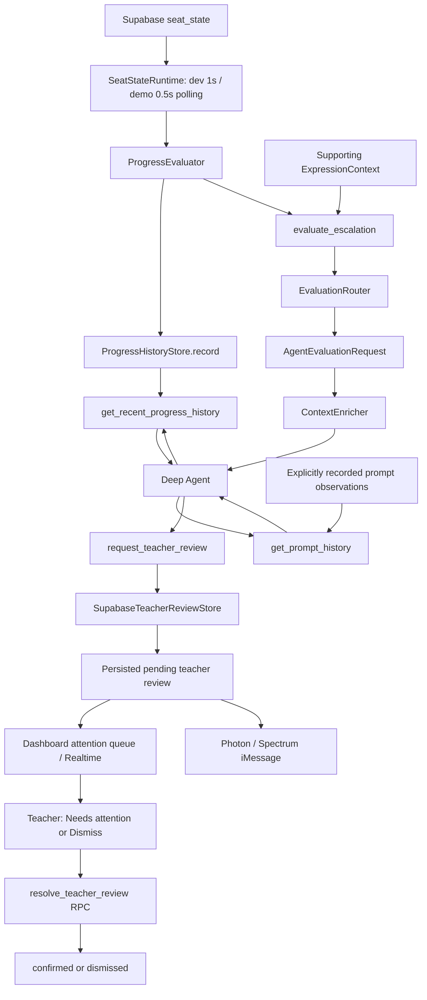

# Michelle — routing / agent implementation

Current consolidated status: November 14, 2026. This document describes the final
implemented behavior; earlier incremental plans and superseded live-test failures
have been replaced by the verified outcomes and remaining limitations below.

## Implemented architecture

The model chooses information tools only when useful. Photon is invoked by the
persistence path after a new pending review is stored. It is not an agent tool.
Dashboard person-ID/read-policy alignment remains an integration gap; the diagram
shows the review handoff, not a claim that every live person is already visible.

## Deterministic progress and routing

`agent/progress.py` consumes the canonical shared `SeatState` model. It returns
`ProgressState(trend, stalled_seconds)`, with improving, stalled, completed, or
unknown. The four-second default rolling window compares early and late score
means. Improvement enters at a 0.10 increase and remains improving down to 0.05,
limiting noise oscillation. Half-second buckets bound sampling density.

Task success uses supplied activity configuration: gesture success_threshold or
explicit done status for rule tasks. No universal score threshold is imposed.
Completion latches until reset or identity change. Tracking invalidity, idle or
tracking-lost status, missing gesture scores, stale observations, and gaps over
two seconds clear the window. Duplicate/out-of-order/future observations do not
advance progress. Tracking loss never counts as student failure.

`agent/escalation.py` provides pure `evaluate_escalation`. Only stalled progress
can qualify; expression alone cannot trigger evaluation.

| Configuration | Default | Demo |
|---|---|---|
| Progress window | 4 seconds | 2 seconds |
| min_observation_seconds | 5 | 2 |
| normal_stall_seconds | 10 | 4 |
| expression_assisted_seconds | 6 | 5 |
| prolonged_stall_seconds | 15 | 6 |
| Expression persistence | 5 seconds | 5 seconds |

Qualifying expression context is anger/fear/sadness with probability at least
0.5 and persistence at least five seconds. It supports an established stall.
Demo timings are for presentation speed, not classroom recommendations.
These are engineering choices rather than educational or clinical thresholds.

`EvaluationRouter.route(snapshot, progress, decision)` returns an
`AgentEvaluationRequest` once per stronger eligible level within a
session/seat/activity episode. Improving/completed rearm the episode; unknown
pauses suppression. There is no timed cooldown or durable delivery guarantee.
Requests carry trusted identity, observation time, progress and escalation.
`ContextEnricher.enrich(request)` adds the matching shared Activity; unknown
activities fail rather than guessing. Agent serialization excludes legacy
`no_progress_seconds`, which does not control current routing eligibility.

## Information tools and history

`ProgressHistoryStore.record(snapshot, progress)` stores evaluated summaries:
observed_at, trend and stalled_seconds. Retrieval is chronological and scoped to
session/seat/activity. Retention is 50 summaries per identity by default;
duplicate timestamps replace a summary. The continuous runtime records accepted
observations automatically. This is process-local history, not Supabase history.

`PromptHistoryStore.record(session_id, seat_id, activity_id, entry)` stores only
observed outcomes: independent_correct, prompted_correct, incorrect, no_response,
with observed_at. Default retention is 50 entries per identity and 100 identities.
No production observation producer is implemented. SeatState does not imply a
prompt outcome, support level, motivation, diagnosis or behavioral function.

Both registered information tools return at most 10 recent entries for the
current trusted identity, filtered to the request time. Empty results are missing
data, not negative evidence or escalation evidence. Research rationale for these
tools remains in PRD §12.6; it is not duplicated here.

## Deep Agent and guardrails

`create_cues_deep_agent(model, history, ..., reviews=reviews)` is provider-independent.
`agent.run(context)` returns `AgentRunResult(assessment, pending_review)`.
The current live/demo wrapper injects Groq `openai/gpt-oss-20b`.

Registered tools:
- `get_recent_progress_history`: isolated versus repeated progress patterns.
- `get_prompt_history`: observed independence/support patterns.
- `request_teacher_review`: create a pending review using trusted application identity/priority.

Receiving a routed request already establishes deterministic evaluation
eligibility; the model must not apply another activity timeout. It may use neither,
either, or both history tools, depending on what would improve its decision.

Structured assessment includes continue_monitoring or teacher_review_warranted,
a nonblank rationale capped at 500 characters, and constrained unique
`evidence_used`: current_progress, activity, recent_progress_history, prompt_history.
History labels require nonempty usable tool results. Calling a tool alone does
not establish evidence. Strict validation allows one model correction for
unavailable evidence, inside the existing budget; application code does not strip
labels or invent observations.

Limits remain four model calls and three domain-tool attempts per run.
Identical successful information queries reuse their result. History retrieval
is bounded to 10 entries. Groq uses a 20-second timeout and at most two transient
retries. These limits control latency/reliability, not learner support thresholds.

Successful review creation terminates from the trusted stored assessment and
review artifact without another model turn. No new rationale is fabricated.
Temporal claims use deterministic supplied durations or qualitative wording;
the model is instructed not to calculate elapsed spans from timestamps.

No images/video go to the LLM. Do not diagnose or infer internal emotional state.
Expression remains supporting context. Teacher review does not autonomously
change instruction.

## Why this is a Deep Agent

The implemented graph selects tools adaptively, consumes their results within
the same run, and can condition an action on gathered evidence. Live Groq runs
demonstrated progress-history and prompt-history selection, and conditional
history → request_teacher_review behavior. A both-information-tools path was
not observed in the documented live runs. Tool selection and model reasoning
quality remain variable; scripted tests establish mechanics rather than reasoning
quality. A successful action now ends the run without post-action budget exhaustion.

## Teacher review persistence and human resolution

`TeacherReviewStore` remains available for offline tests.
`SupabaseTeacherReviewStore(client, notifier=...)` implements the same API:
request_teacher_review, get_review, get_pending_reviews,
confirm_needs_attention, dismiss_review.

A review preserves UUID, created_at, complete trusted evaluation, assessment,
evidence, status and resolved_at. Only pending reviews may transition:
- Needs attention → confirmed.
- Dismiss → dismissed.

Resolution records the teacher decision and aware resolution timestamp, preserving
the original identity, priority and assessment. Unknown IDs and repeat/opposite
resolution fail cleanly. Resolution is deterministic and outside the LLM.

Migration 003 persists flattened context plus complete evaluation JSON in
teacher_reviews, with unique-evaluation deduplication, immutable trusted fields,
pending-only transitions, RLS and Realtime INSERT/UPDATE publication.
Duplicate insertion reuses the existing pending record without rewriting it.
Persistence failures are explicit; configured persistence never silently falls
back to memory.

Migration 004 adds authenticated `resolve_teacher_review(review_id, action)`.
It locks the row, permits confirmed/dismissed only, and timestamps server-side.
Direct browser writes remain denied. Current authorization is demo-only:
any authenticated user can resolve simulated-seat reviews. Real session ownership
and classroom authorization are not implemented.

Hosted schema, lifecycle, immutable fields, RLS, authenticated RPC and public-key
Realtime INSERT/UPDATE were verified. Probe reviews and temporary Auth users were
removed. Migration 005 added nullable seat_state.tracking_valid with no default;
live vision sink upserts persisted true/score and false/null-score correctly.

## Photon / Spectrum

The Supabase INSERT winner invokes the injected notifier only after persistence
and typed validation. Duplicate reuse and confirmed/dismissed transitions never
notify. Notification failure retains the pending review and logs sanitized
failure information; no rollback or automatic retry occurs.

Message content is limited to:
“Cues: Seat <seat_id> may need attention. Open Cues to review.”
No expression, reasoning, images or intervention instructions are sent.

Backend configuration lives in `cues/.env`: SPECTRUM_PROJECT_ID,
SPECTRUM_PROJECT_SECRET, SPECTRUM_TEACHER_PHONE and optional SPECTRUM_SENDER_PHONE.
The fixed teacher destination must be active/allowed in Spectrum Users;
dynamic teacher phone-profile lookup is not implemented. `cues/src/notify.ts`
loads the nested env relative to its module and passes project credentials explicitly.
SDK logs are suppressed and diagnostics redact credentials and phone numbers.

The first send failed with “Target not allowed for this project”. After the
destination was activated, direct sending and the later hosted pipeline smoke
received nonempty acknowledgements. This verifies Spectrum acceptance, not a
device read receipt. The subprocess has a 25-second bound.
Insert-winner suppression is at-most-once attempt behavior, not durable delivery;
there is no outbox or automatic recovery after a process crash.

## Continuous runtime and local startup

`create_seat_state_runtime(model, activities, ...)` in `agent/runtime.py`
composes the existing nodes. It reuses the authenticated review-store client.
`SeatStateRuntime.run_forever()` polls public.seat_state at one-second intervals
by default; the demo worker explicitly uses half-second intervals;
`run_once()` supports supervised iterations and tests. No Python Realtime pattern
previously existed, so polling is used. Exact unchanged rows are skipped.

Evaluators are partitioned by session/seat/activity. Existing evaluators retain
authority over freshness/order/gaps; only newly accepted observations enter
progress history. Row validation, unknown activity and provider failures are
isolated per row. Source failures are logged and retried at the polling cadence.
Logs use seat IDs and exception classes without dumping payloads or secrets.

Backend configuration uses nonempty process values over root .env and local
web/.env.local fallback; nested cues/.env supplies Spectrum configuration.
SUPABASE_URL and SUPABASE_SERVICE_ROLE_KEY select hosted persistence. Explicit
offline/source injection supports tests. Missing/partial/broken live persistence
fails clearly.

`agent/worker.py` injects the demo model and loads shared Activity fields from
the local vision activity catalog at startup. Restart after catalog changes.
`./scripts/dev.sh` starts vision, the worker and Next.js through `agent/dev.py`.
Logs are prefixed; Ctrl-C/SIGTERM terminates process groups. Photon runs on demand.
See STARTUP.md for exact dependencies, env, flags and manual prerequisites.
The launcher has passed shell syntax and Python lint checks; a full launch and
Ctrl-C cleanup were not exercised in the documented startup change.

### Live stalled-progress trace

The camera reproduction confirmed demo mode was active: window/minimum 2s,
normal 4s, expression-assisted 5s and prolonged 6s. Tracking remained true,
raise_hand score was 0, and vision status remained in_progress while the agent
emitted stalled. One-second polling plus HTTP time occasionally skipped a
roughly one-second heartbeat, yielding a 2.06s gap and resetting progress to
unknown. Demo now explicitly polls every 0.5s; normal polling and all evaluator
thresholds remain unchanged. Slow synchronous agent runs can still cause gaps;
the evaluator conservatively resets instead of treating unseen time as failure.

Startup logs now print actual timing configuration. Per-seat transition logs
include score/tracking, observation age/gap, progress, escalation, route outcome,
and evaluation result/review ID, without frame data or teacher contact details.
The source also reads session_revision for diagnostics.

The original active session's owner had no consent settings. After a new owned
session was started, the live trace reached stalled at 2.00s, normal evaluation
at 4.07s (model chose continue_monitoring), then prolonged evaluation at 6.07s.
Pending review 267e69f2-dc96-423a-890d-1e345a55d688 was persisted at 22:14:33 UTC;
Spectrum acceptance was recorded at 22:14:35 UTC. Michelle confirmed dashboard
review and handset message at 5:14 PM. No notification logic or RLS was changed.
"Working" is the vision status; no separate persisted stalled label exists.
Fresh session identity resets progress; completion remains latched within a task.

Tests cover demo/dev configuration, heartbeat sampling, transition-only logging,
new-session reset, and the existing real review-action path. The live success
preceded the half-second polling adjustment, which applies on the next restart.

## Verification and remaining work

### Opted-in Photon recipient registration (local implementation)

Migration 009 adds teacher_notification_settings with explicit opt-in and server
consent timestamp, consented phone snapshot, explicit first/last names, project,
registration attempt UUID, status, registered timestamp and safe failure category.
Browsers can read only their own row; writes and the preparation RPC are backend
service-only. A profile phone update invalidates consent and registration in the
same transaction. Preparation locks the profile; attempt IDs remain available to
bind future trusted completion to the current consent request.

POST /api/notifications/register verifies the Supabase bearer token with getUser,
uses authoritative confirmed Auth email, and obtains the phone from the profile
through the service preparation RPC. Body accepts only opt_in, first_name and
last_name. Names are explicit, not parsed from display text. opt_in:false revokes.
No profile, station membership, session or review is removed on provider failure.

Photon recipient provisioning is manual for the hackathon. After explicit opt-in,
the operator adds/invites the current consented recipient through the Photon/
Spectrum website. Cues no longer automates CLI provisioning or reads an operator's
Photon Dashboard OAuth session. Runtime sending remains separate and uses the
Spectrum project ID/secret.

The endpoint records consent and queues manual activation, returning pending /
“Notifications: activating”. Migration 009 remains deployed and unchanged; its
registering status represents pending activation. Existing registration attempts,
safe failure fields, and registered status are retained.

Dynamic send eligibility is explicit opt-in, consented phone=current profile phone,
a current registration attempt, and matching project. Registered status is an
observation of accepted delivery, not a pre-send gate. Phone changes revoke consent.
The first accepted test or real review notification marks the exact attempt registered,
sets a server timestamp and clears safe errors. New migration 010 (not deployed)
implements record_teacher_notification_send: service-only, profile lock followed by
an atomic user/phone/attempt/project/opt-in guarded update. Stale responses cannot
activate a different phone or consent attempt; consent timestamps/profile stay intact.

The existing profile UI includes Send test notification only for current matching
consent. POST /api/notifications/test verifies auth and accepts no body/identity.
It runs in Node on the web server (`web/lib/notification-send.ts`) with the same eligibility checks and
the same guarded `record_teacher_notification_send` RPC as the agent's Python sender, and the
provider call is the shared `web/lib/spectrum-send.ts` that the local `cues/src/notify.ts` also uses
(no Python subprocess, so it works on Vercel). Backend-only project credentials come from the
server environment. “Target not allowed” returns activating with a retry message;
other failures record provider_failure/network_failure only. Pending reviews survive.
Manual Photon website provisioning is still required; manual Supabase SQL is not.
No CLI provisioning, admin system, static fallback, or station/session changes.
Accepted means Spectrum acknowledgement, not independent proof of handset delivery.

Verification: 299 backend/shared/Supabase tests passed, including isolated full-chain
migration replay, stale-attempt/phone/reconsent guards and pending-review preservation.
98 frontend tests, TypeScript and ESLint passed; changed Python files pass Ruff.
The unmodified full-suite run exposed four unrelated vision tests that assume the
station-lifecycle flag is off. With CUES_FLAG_VISION_SESSION_LIFECYCLE=0 explicitly
set for those legacy assumptions, the full suite passed: 502 passed, 4 skipped.
No hosted migration, website provisioning or live notification send was performed.

### Migration history reconciliation

Historical duplicate versions were resolved by filename-only moves:
00300_session_controls → 00310_session_controls,
00400_person_observations → 00510_person_observations, and
00500_station_session_sync → 00520_station_session_sync (same date prefix).
All eleven migrations replayed on isolated local PostgreSQL with minimal Auth
stubs. Hosted definitions/effects through 007 were verified; official CLI 3.1.0
marked only those ten versions applied without replaying their SQL. The resulting
official migration list matches through 007, and db push --dry-run selected only
008_station_pairing. Migration 008 was not deployed. See notes/supabase.md for
the pinned CLI commands, explicit targeting helper and future deployment procedure.

### Station pairing backend (local, not deployed)

Migration 008 adds private station_pairing_codes and service-only
issue_station_pairing_code(station_id, ttl_seconds=600), returning a random code
once while storing only its normalized SHA-256 hash. Authenticated callers redeem
with redeem_station_pairing_code(code), returning [{station_id}]. Row locking,
expiry validation, membership insertion for auth.uid() and consumption happen in
one transaction; concurrent use has one winner. Existing membership is harmless
and still consumes a fresh code. Invalid/expired/used codes share one generic error.
No browser membership inserts, arbitrary identity/station arguments, historical
session claims or changes to session RPCs are introduced. Service access remains.
Operator/frontend instructions and isolated local PostgreSQL test command are in
notes/supabase.md. Four SQL integration tests passed, including concurrent
redemption, privacy/permissions, normalization, repeat membership, rejection cases,
and unchanged historical sessions. No Photon registration or UI was added.

### Teacher profile and destination ownership

Migration 006 adds teacher_profiles(user_id, display_name, phone_number,
created_at, updated_at) and sessions.teacher_id referencing Auth users.
Email remains in Supabase Auth. Profile RLS allows each authenticated user to
read/insert/update only their own profile; phone formatting is normalized and
validated as international E.164. created_at is preserved and updated_at is
generated server-side. Existing sessions remain unowned until trusted assignment.

Review reads and resolve_teacher_review now require ownership of the review's
session. Pending-only transitions and immutable context remain enforced.
Testing = static mode 1; actual demo = dynamic mode 0. demo.sh forces 0;
dev.sh remains overrideable. Dynamic lookup follows session teacher_id to the
profile phone and never falls back to SPECTRUM_TEACHER_PHONE. The phone travels
only through the backend sender boundary, never agent messages/review context.
Missing phone or Spectrum rejection leaves the persisted pending review intact.

Frontend contract for Evan: authenticate with Supabase Auth (email authority),
upsert teacher_profiles with user_id=auth user.id, display_name and phone_number
(international +country-code number; spaces/parentheses/dashes are normalized).
Null phone is allowed but prevents notification. Read profile with user_id filter.
Create sessions with teacher_id=auth user.id; existing-session ownership requires
trusted backend assignment. Fetch teacher_reviews scoped by session, subscribe
with the authenticated JWT, and call rpc('resolve_teacher_review',
{review_id, action: 'confirmed' | 'dismissed'}). Result is a one-row array.
Do not directly update review fields or expose service-role credentials.

Migration and rollback SQL ownership checks are provided; hosted application
is not claimed in this step. Historical demo-only authorization claims above
describe migration 004 and are superseded by migration 006 once deployed.

Full offline suite (2026-11-14): **about 619 passed, 4 skipped**. Skips are existing hardware
and credential-gated checks. Coverage includes deterministic routing, history
isolation/bounds, evidence repair/budgets, terminal action, review lifecycle,
persistence adapter, notification failure/duplicates, continuous wiring, malformed
rows and isolation between seats.

Hosted `python -m agent.hosted_seat_state_smoke` used five synthetic SeatState
updates and a scripted model. The real reader/evaluators/router/enricher/action
created one persisted pending review, invoked Photon once and received
acknowledgement. Synthetic state/review rows were removed. This proves integration
mechanics; it does not prove live-model judgment quality.

Remaining work:
- Dashboard person-ID visibility/read policies and catalog alignment with vision.
- Real teacher/session authorization and dynamic teacher destination profiles.
- A real producer for observable prompt history; durable progress/prompt history.
- Deployment supervision, restart/delivery recovery and bounded lifecycle cleanup.
- Full-stack hardware/demo acceptance and launcher signal-cleanup verification.
- Instructional/support intervention workflow remains unimplemented.

No new tools, routing nodes, student notifications or autonomous instructional
changes are implied by this implementation.

## Citations

These sources support allowing processing time, not treating a few seconds as
failure. They do **not** establish universal Cues timeouts or validate facial
expression routing. Our 5/6/10/15 defaults are conservative engineering choices
informed by these ranges; activity/learner calibration remains future work.
The 2/5/4/6 preset is demonstration-only.

- [IRIS Center, Vanderbilt — Wait-Time](https://iris.peabody.vanderbilt.edu/et/wp-content/uploads/misc_media/fss/pdfs/2018/IRIS_fundamental_skill_sheet_wait-time.pdf).
  The supplied PDF redirects to the current skill sheet. It describes benefits
  of 3–5 seconds across groups including students with disabilities, supporting
  an opportunity to process and begin responding before intervention.
- [NPDC — Prompting: Least-to-Most, Steps for Implementation](https://autisminternetmodules.org/storage/ocali-ims-sites/ocali-ims-aim/documents/PromptsLeasttoMostSteps.pdf).
  Response intervals are initially around 3–5 seconds and should reflect learner
  and task characteristics; initiation and completion intervals can differ.
- [STAR Autism Support — Routine Essentials: Prompting Strategies](https://starautismsupport.com/sites/default/files/CEC_STAR_Inclusion_2025.pdf), page 12 of the booklet.
  Gives 5–10 seconds as an example opportunity to respond before prompting.
- [Johnson & Parker — Effects of Wait Time when Communicating with Children who have Sensory and Additional Disabilities](https://journals.sagepub.com/doi/10.1177/0145482X1310700505), Journal of Visual Impairment & Blindness.
  The abstract describes three participants and 5-, 10-, and 15-second conditions
  compared with a 0–1-second baseline. Responses were more frequent during
  intervention; the implications suggest at least five seconds may help. This
  small communication study does not establish gesture-task escalation thresholds.
- [Stahl — Using Think-Time and Wait-Time Skillfully in the Classroom](https://eric.ed.gov/?id=ED370885), ERIC Digest.
  Supports uninterrupted processing intervals of several seconds rather than
  interpreting immediate nonresponse as failure. The ERIC abstract was verified through search after direct access timed out;
  it describes benefits after at least three seconds of uninterrupted silence.
- [Goodwin et al. — Effective Classroom Questioning, ERIC ED285497](https://files.eric.ed.gov/fulltext/ED285497.pdf).
  Discusses processing/formulating responses, benefits of several seconds of
  wait-time, and context-specific cautions about 20–30-second silent waits.
  This classroom question-answer guidance is not a universal maximum for physical
  tasks or learners who need longer response times.

### Station-isolation integration

Live agent composition injects a local `/config` station provider. The source filters
by active station session, current activity/revision and station seat IDs; unconfigured
vision returns no observations. Revision changes reset completion and routing suppression.
Both startup profiles default lifecycle on without requiring a legacy session UUID.
Dashboard/connected Live pause unresolved feeds. Local handoff failures are surfaced,
and sign-out clears unpinned vision state. Session-owner Photon routing is unchanged.
Migration 011 and hosted teacher defaults require separate deployment verification.

### Live progress UI publication and README audit

Added a guarded agent-owned evaluated_progress summary on seat_state (migration 012).
The pipeline publishes current trend/stall plus ten recent revision-scoped summaries
before model evaluation. It reuses existing history models and the Realtime channel;
no new perception fields, browser trend calculation, or polling feedback loop.
UI projection validates session/activity/revision/tracking/freshness; stale summaries
are hidden. Both live-progress rollout flags default off until schema deployment.
The README diagram now branches history from progress and places resolution RPC before
confirmed/dismissed. `notes/pipeline-audit.md` audits every edge and records configuration
constants and operational gaps explicitly. Migration 012 was subsequently deployed with explicit approval; both local flags are enabled.

Final live progress rollout verified S2-P1: stalled at 4.066419 seconds with ten
recent entries, observed 1.3 seconds after capture. Hosted migrations are up to date.
